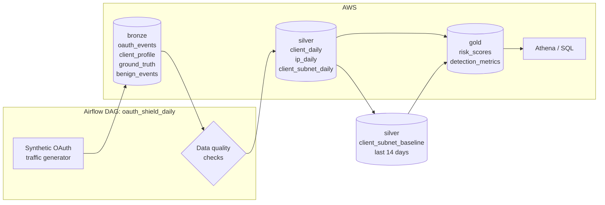
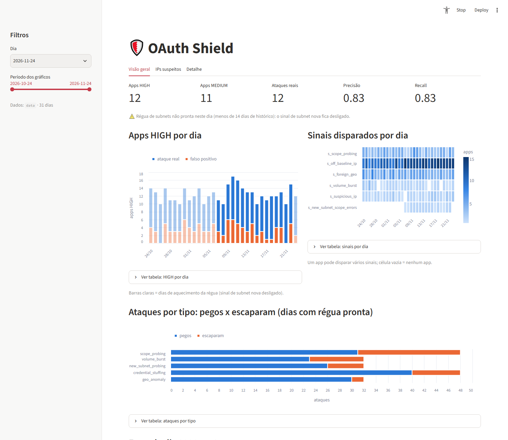

# OAuth Shield Pipeline

[](https://github.com/guedesdaniel/oauth-shield-pipeline/actions/workflows/ci.yml)

A daily **Apache Airflow** pipeline that scores OAuth 2.0 client applications for fraud risk. It writes a **medallion data lake on AWS S3** (Parquet) and makes it queryable with **Athena**. The infrastructure is defined in **Terraform**.

It is inspired by my day job on an OAuth 2.0 authorization server for Open Finance and Banking-as-a-Service. **All data here is synthetic.** No real client, token or traffic pattern from any company is used.

## Why

An authorization server sees every token request. Failed requests are a goldmine for fraud detection, and they are usually only looked at during incident tickets. Examples of what they reveal:

- an app asking for scopes it was never granted;
- one IP hammering dozens of apps;
- valid credentials suddenly used from abroad.

This project turns that traffic into a daily, **explainable** risk score per client application. It also **measures detection quality** against injected attacks, so every threshold change can be evaluated instead of guessed.

## Architecture



| Layer | Table | Content |
|---|---|---|
| bronze | `oauth_events` | One row per token request: client, source IP, country, requested scope, HTTP status |
| bronze | `client_profile` | Declared registry of client apps: allowed scopes, registered IPs, expected daily volume. Only updated when a client reports a change |
| bronze | `ground_truth` | Which clients were attacked that day, and how (used only for evaluation) |
| bronze | `benign_events` | Legitimate behaviour that looks suspicious: subnet migrations, misconfigured releases, foreign cloud regions (used only to explain false positives) |
| silver | `client_daily` | Daily success/error counts, invalid scopes, off-baseline IPs, foreign traffic per client |
| silver | `ip_daily` | Requests, failures and distinct clients per source IP |
| silver | `client_subnet_daily` | Requests, tokens issued and scope errors per client and /24 subnet |
| silver | `client_subnet_baseline` | The /24 subnets each app *usually* issues tokens from, learned from the previous 14 days (the subnets covering 95% of its tokens) |
| gold | `risk_scores` | 0–100 score, LOW/MEDIUM/HIGH level and the reasons that fired, per client |
| gold | `detection_metrics` | Precision and recall of HIGH flags vs. ground truth |

Every table is partitioned by `dt=YYYY-MM-DD`. Athena discovers new partitions through **partition projection**, so there are no crawlers and no `MSCK REPAIR`.

## Detection signals

| Signal | Rule (defaults) | Weight | Catches |
|---|---|---|---|
| `s_scope_probing` | ≥ 10 `invalid_scope` errors and ≥ 5% of requests | 40 | Apps probing for permissions they don't have |
| `s_suspicious_ip` | ≥ 10 hits from an IP that failed on ≥ 10 different clients | 40 | Credential stuffing / spraying |
| `s_foreign_geo` | ≥ 5 requests from outside the home country | 40 | Stolen credentials used abroad |
| `s_volume_burst` | Volume ≥ 3× the expected daily baseline | 25 | Token farming |
| `s_off_baseline_ip` | ≥ 25% of traffic from IPs not in the declared registry | 25 | Infrastructure change or takeover |
| `s_new_subnet_scope_errors` | ≥ 5 `invalid_scope` errors from a /24 that is not usual for the app (learned baseline), counted per subnet and never diluted by the app's total volume | 40 | Stolen credentials used once from a new network, probing for scopes, on a high-volume app |

Score = sum of weights, capped at 100. **HIGH ≥ 40**, MEDIUM ≥ 20. Each flagged client carries a human-readable `reasons` string.

**Current results** (30-day backfill, 2026-10-24 to 2026-11-22): about 127k events/day from 300 client apps, with 12 injected attacks per day. The first 14 days only build the subnet baseline. On the 16 days where it is ready:

| Metric | Mean | Worst day |
|---|---|---|
| Precision | 0.75 | 0.60 |
| Recall | 0.78 | 0.67 |

- Recall by attack type: geo anomaly 0.94, credential stuffing 0.83, new-subnet probing 0.81, volume burst 0.72, scope probing 0.65.
- All 54 false positives come from legitimate lookalikes the generator plants on purpose. They are logged in `benign_events`: 32 misconfigured scopes, 21 trips abroad and 1 network migration that the client did not notify. The design accepts a false positive rather than loosening the rules.
- `python scripts/simulate.py --end 2026-11-22 --days 30` reproduces these numbers in memory in about a minute, which is how the generator was tuned.

## Run it locally (no cloud account needed)

Requirements: Docker Desktop and Git.

```bash
git clone https://github.com/guedesdaniel/oauth-shield-pipeline.git
cd oauth-shield-pipeline
cp .env.example .env          # Windows PowerShell: Copy-Item .env.example .env
docker compose up --build
```

1. Open http://localhost:8080 and enable the `oauth_shield_daily` DAG.
2. Trigger it.
3. The Parquet output lands in `./data/`.
4. For 30 days of history (the subnet baseline needs 14), run a backfill one day at a time:
   `docker compose exec airflow airflow backfill create --dag-id oauth_shield_daily --from-date 2026-10-24 --to-date 2026-11-22 --max-active-runs 1 --reprocess-behavior completed`

## Dashboard (local)



A Streamlit app reads the Parquet layers with DuckDB. It only reads what the pipeline wrote: no score or metric is recomputed, and precision and recall come from `detection_metrics`.

- **Overview.** Shows the day's cards (HIGH, MEDIUM, real attacks, precision, recall) and a chart of HIGH apps per day, split into real attacks and false positives. Baseline warm-up days are shaded. Two more charts show signals per day as a heatmap and caught vs. missed attacks by type. The day's errors are listed too: each false positive comes with the legitimate event that explains it, and each missed attack with its type.
- **Suspicious IPs.** Ranks IPs that failed on the most apps. It also lists scope errors coming from a /24 that the app does not usually use.
- **Detail.** For one app, shows volume against expected volume per day, with HIGH days marked, plus its reasons, the ground truth and its subnets against the learned baseline. For one IP, lists every app it called, by day and status code.

Run it with `docker compose up` (service `dashboard`, http://localhost:8501), or from a virtualenv:

```bash
pip install -r requirements-dashboard.txt
streamlit run dashboard/app.py      # DATA_DIR defaults to ./data
```

The queries live in [`src/oauth_shield/dashboard_queries.py`](src/oauth_shield/dashboard_queries.py) and are unit-tested on a tiny hand-checked dataset.

## Run it on AWS

Requirements: an AWS account, the AWS CLI configured with an admin profile, and Terraform ≥ 1.6.

```bash
cd infra/terraform
cp terraform.tfvars.example terraform.tfvars   # set alert_email
terraform init
terraform apply
```

1. Create an access key for the IAM user `oauth-shield-airflow` (shown in the Terraform outputs).
2. In `.env`, set `STORAGE_BACKEND=s3`, `S3_BUCKET=<bucket_name output>` and the access key.
3. Restart with `docker compose up` and trigger the DAG again.
4. Query the results in Athena (workgroup `oauth-shield`). See [`sql/athena_queries.sql`](sql/athena_queries.sql).

**Cost:** a few cents per month. Terraform also creates:

- a **USD 5 budget alert**;
- a **1 GiB scan cap** per Athena query;
- lifecycle rules that expire raw data after 30 days.

`terraform destroy` removes everything.

## Development

```bash
pip install -r requirements-dev.txt
pytest -q          # generator, aggregates, risk rules, storage
ruff check src tests dags scripts
```

On every push, CI runs lint, the tests, `terraform fmt` and `terraform validate`.

## Roadmap

- [x] Harder scenarios: learned subnet baseline, new-subnet probing, legitimate lookalikes
- [x] Local analytics dashboard (Streamlit + DuckDB)
- [ ] Threshold tuning with precision/recall curves
- [ ] Unsupervised scoring (Isolation Forest) compared against the rules
- [ ] Same-day (D0) detection: stream events through Kafka instead of a daily batch
- [ ] dbt models for the silver/gold layers
- [ ] Deploy Airflow on AWS (MWAA or ECS) instead of locally

## Author

**Daniel Guedes dos Santos**, Data & Backend Engineer working on OAuth 2.0 and Open Finance. [LinkedIn](https://www.linkedin.com/in/danielgds12/)
