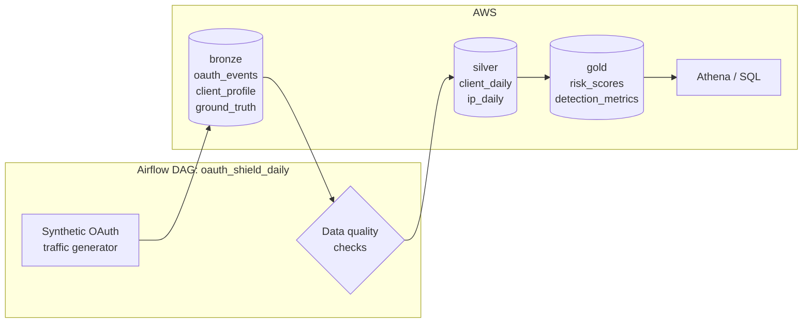

# OAuth Shield Pipeline

[](https://github.com/guedesdaniel/oauth-shield-pipeline/actions/workflows/ci.yml)

A daily **Apache Airflow** pipeline that scores OAuth 2.0 client applications for fraud risk. It writes a **medallion data lake on AWS S3** (Parquet) and makes it queryable with **Athena**. The infrastructure is defined in **Terraform**.

It is inspired by my day job on an OAuth 2.0 authorization server for Open Finance and Banking-as-a-Service. **All data here is synthetic.** No real client, token or traffic pattern from any company is used.

## Why

An authorization server sees every token request. Failed requests are a goldmine for fraud detection, and they are usually only looked at during incident tickets. Examples of what they reveal:

- an app asking for scopes it was never granted;
- one IP hammering dozens of apps;
- valid credentials suddenly used from abroad.

This project turns that traffic into a daily, **explainable** risk score per client application. It also **measures detection quality** against injected attacks, so every threshold change can be evaluated instead of guessed.

## Architecture



| Layer | Table | Content |
|---|---|---|
| bronze | `oauth_events` | One row per token request: client, source IP, country, requested scope, HTTP status |
| bronze | `client_profile` | Registry of client apps: allowed scopes, usual IPs, expected daily volume |
| bronze | `ground_truth` | Which clients were attacked that day, and how (used only for evaluation) |
| silver | `client_daily` | Daily success/error counts, invalid scopes, off-baseline IPs, foreign traffic per client |
| silver | `ip_daily` | Requests, failures and distinct clients per source IP |
| gold | `risk_scores` | 0–100 score, LOW/MEDIUM/HIGH level and the reasons that fired, per client |
| gold | `detection_metrics` | Precision and recall of HIGH flags vs. ground truth |

Every table is partitioned by `dt=YYYY-MM-DD`. Athena discovers new partitions through **partition projection**, so there are no crawlers and no `MSCK REPAIR`.

## Detection signals

| Signal | Rule (defaults) | Weight | Catches |
|---|---|---|---|
| `s_scope_probing` | ≥ 10 `invalid_scope` errors and ≥ 5% of requests | 40 | Apps probing for permissions they don't have |
| `s_suspicious_ip` | ≥ 10 hits from an IP that failed on ≥ 10 different clients | 40 | Credential stuffing / spraying |
| `s_foreign_geo` | ≥ 5 requests from outside the home country | 40 | Stolen credentials used abroad |
| `s_volume_burst` | Volume ≥ 3× the expected daily baseline | 25 | Token farming |
| `s_off_baseline_ip` | ≥ 25% of traffic from IPs never seen for this app | 25 | Infrastructure change or takeover |

Score = sum of weights, capped at 100. **HIGH ≥ 40**, MEDIUM ≥ 20. Each flagged client carries a human-readable `reasons` string.

**Current results:** about 85k events/day, 300 client apps and 12 injected attacks per day. The rules reach precision 1.0 and recall 1.0. That is expected, because the attacks in this synthetic data are loud by design. The value of the project is the pipeline and the evaluation harness. The roadmap adds stealthier attacks to make the trade-offs visible.

## Run it locally (no cloud account needed)

Requirements: Docker Desktop and Git.

```bash
git clone https://github.com/guedesdaniel/oauth-shield-pipeline.git
cd oauth-shield-pipeline
cp .env.example .env          # Windows PowerShell: Copy-Item .env.example .env
docker compose up --build
```

1. Open http://localhost:8080 and enable the `oauth_shield_daily` DAG.
2. Trigger it.
3. The Parquet output lands in `./data/`.

## Run it on AWS

Requirements: an AWS account, the AWS CLI configured with an admin profile, and Terraform ≥ 1.6.

```bash
cd infra/terraform
cp terraform.tfvars.example terraform.tfvars   # set alert_email
terraform init
terraform apply
```

1. Create an access key for the IAM user `oauth-shield-airflow` (shown in the Terraform outputs).
2. In `.env`, set `STORAGE_BACKEND=s3`, `S3_BUCKET=<bucket_name output>` and the access key.
3. Restart with `docker compose up` and trigger the DAG again.
4. Query the results in Athena (workgroup `oauth-shield`). See [`sql/athena_queries.sql`](sql/athena_queries.sql).

**Cost:** a few cents per month. Terraform also creates:

- a **USD 5 budget alert**;
- a **1 GiB scan cap** per Athena query;
- lifecycle rules that expire raw data after 30 days.

`terraform destroy` removes everything.

## Development

```bash
pip install -r requirements-dev.txt
pytest -q          # generator, aggregates, risk rules, storage
ruff check .
```

On every push, CI runs lint, the tests, `terraform fmt` and `terraform validate`.

## Roadmap

- [ ] Harder scenarios (low-and-slow attacks, legitimate traffic spikes) and threshold tuning with precision/recall curves
- [ ] Unsupervised scoring (Isolation Forest) compared against the rules
- [ ] Same-day (D0) detection: stream events through Kafka instead of a daily batch
- [ ] dbt models for the silver/gold layers
- [ ] Deploy Airflow on AWS (MWAA or ECS) instead of locally

## Author

**Daniel Guedes dos Santos**, Data & Backend Engineer working on OAuth 2.0 and Open Finance. [LinkedIn](https://www.linkedin.com/in/danielgds12/)
